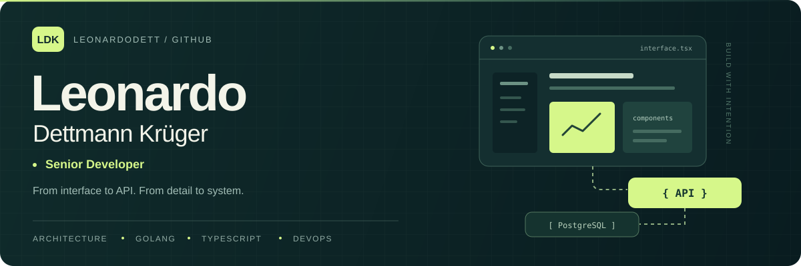
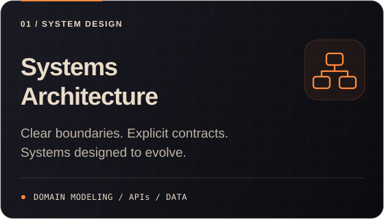
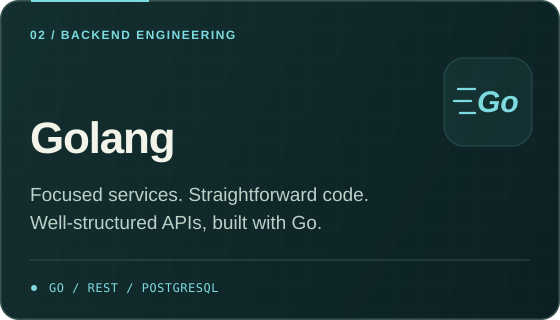
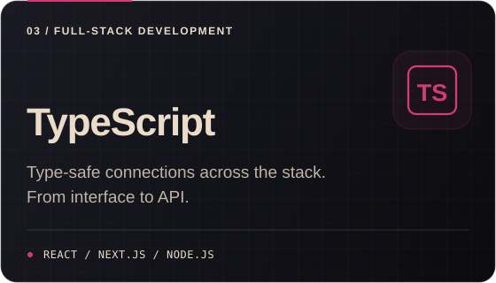
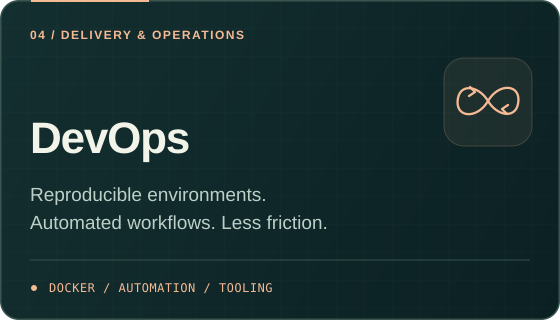

  

  <a href="#about">About</a> &nbsp; / &nbsp;
  <a href="#core-expertise">Core expertise</a> &nbsp; / &nbsp;
  <a href="https://github.com/LeonardoDett?tab=repositories">Explore repositories ↗</a>

## About

I'm passionate about **software development and systems architecture**. I enjoy discovering new technologies and exploring their different applications, continually expanding and updating my knowledge to find the best solutions to a wide range of challenges.

In my spare time, I experiment with new technologies, build libraries, and create applications that help solve everyday problems.

> *“No wind is favorable to a ship without a course.”*

## Core expertise

  
  

  
  

**Also in my toolkit:** Fastify · Drizzle ORM · Zod · Tailwind CSS · Storybook · Radix UI · pnpm · Turborepo

---

  <strong>Leonardo Dettmann Krüger</strong> &nbsp; · &nbsp; From interface to API. From detail to system.

